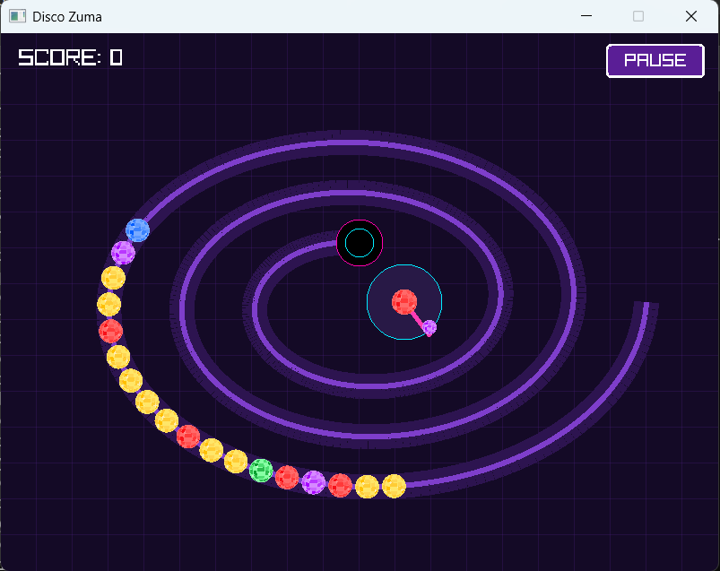

# Disco Zuma

A C++ implementation of the classic **Zuma** game, developed for the **Software Engineering** course.

## Project Structure

The application is modularly structured to keep game logic completely separated from the graphical user interface:

* **`Zuma/` (Backend / Game Logic)** — a static library (`.lib`) that handles game state, ball movement along the spiral track, collisions, match-3+ removal, and scoring. It exposes a decoupled API via the `IGame` interface and notifies state changes using the **Observer** design pattern (`IGameObserver`).
* **`zuma-fe/` (Frontend / UI)** — the graphical client built with **raylib**, strictly responsible for rendering visuals, menu/difficulty screens, and handling user input.
* **`ZumaTests/` (Unit Tests)** — unit testing project powered by **GoogleTest** and **GoogleMock** *(to be added)*.

## Controls

* **Mouse** — Aim
* **Left Click** — Shoot ball
* **Right Click / `Space`** — Swap current and next ball
* **`P`** — Pause game
* **`F`** — Toggle Fullscreen
  
## How to Run

1. Open `Zuma.slnx` in Visual Studio.
2. Make sure dependencies from `vcpkg.json` (`raylib`) are installed.
3. Set `zuma-fe` as the **Startup Project** and run (`F5`).

## Preview

---

> **Note:** This project is still a work in progress — additional maps and the unit test suite are currently being developed.
